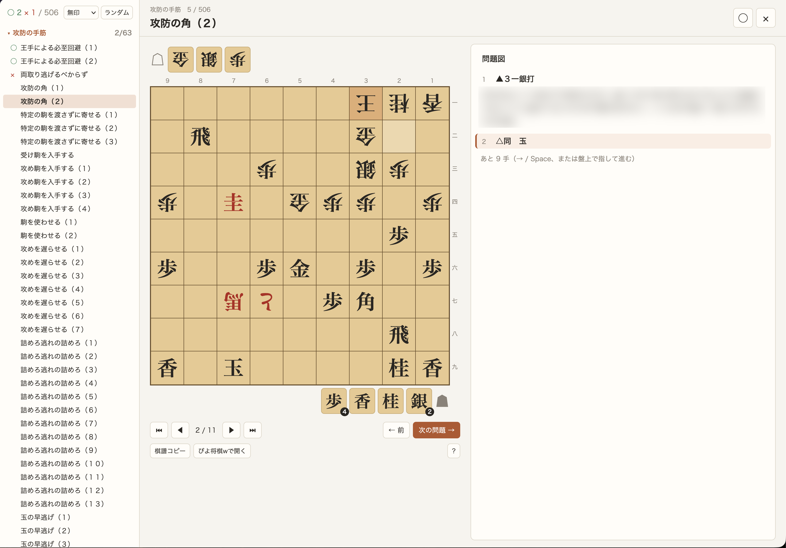

# 将棋の手筋ビューア（個人用）

アプリ「[将棋の手筋](https://apps.apple.com/jp/app/%E5%B0%86%E6%A3%8B%E3%81%AE%E6%89%8B%E7%AD%8B/id1135410052)」の問題データ（全 506 問）を読み出して、盤面と解説を並べて見られるようにしたビューア。



## 機能

- 盤面と解説を並べて表示。1 手ずつ進む / 戻る、次の問題へ
- 盤上で駒を動かして、想定手順どおりの手なら進む（相手の応手は自動）
- 問題ごとに ○ / × の印を付けられる（localStorage に保存）。○ / × / 無印 / すべてからランダム出題
- キーボード操作（アプリ上で `?` を押すと一覧）
- 「棋譜コピー」: 解説付きの KIF をクリップボードにコピー。[ぴよ将棋](https://apps.apple.com/jp/app/%E3%81%B4%E3%82%88%E5%B0%86%E6%A3%8B/id1104881942)の「クリップボードから棋譜を読み込む」や [ぴよ将棋w](https://www.studiok-i.net/ps/) の「棋譜を貼り付け」で読める
- 「ぴよ将棋で開く」: 表示中の局面をぴよ将棋で開く。PC では [ぴよ将棋w](https://www.studiok-i.net/ps/)、スマホではアプリ（解説は付かない）
- スマホでは画面に収まるレイアウト（問題一覧は ☰ から）

## 必要なもの

- Apple Silicon の Mac に「[将棋の手筋](https://apps.apple.com/jp/app/%E5%B0%86%E6%A3%8B%E3%81%AE%E6%89%8B%E7%AD%8B/id1135410052)」をインストールしてあること（iPhone / iPad 版がそのまま Mac で動く。`/Applications/将棋の手筋.app`）
- Nix（Node.js と pnpm は `flake.nix` で用意する）

## 使い方

```sh
direnv allow            # または nix develop
pnpm install
pnpm extract            # アプリから src/generated/problems.json を生成
pnpm build              # dist/index.html を生成（1 ファイル完結。ブラウザで直接開ける）
```

開発用:

```sh
pnpm dev                # 開発サーバ
pnpm preview --host     # ビルド結果を LAN に公開（iPhone などで見るとき）
pnpm check              # Biome（フォーマット・lint）。check:write で修正
pnpm typecheck
```

`src/generated/` はアプリの著作物なので `.gitignore` 済み。公開しないこと。

## 元データの形式

詳しくは `scripts/extract.ts` を参照。

`/Applications/将棋の手筋.app/Wrapper/Tesuji.app/fork.plist`（バイナリ plist）に全問題がカテゴリごとに入っている。各問題の `Record` は、平手の初期配置からルール無視で駒を動かして問題図を作る手順と、解答手順をつなげた棋譜テキスト。

- 1〜(Index+1) 手目が問題図の作成手順、以降が解答手順。作成手順の最後の手は、解説が付いているときだけ実際の直前の手
- `counterCapturedRemovedIndex:N` は、N+1 手目の直後に後手の持ち駒を空にする（余った駒を駒箱に戻す）
- `*` で始まる行は直前の手への解説。`end` 以降は開発メモ
- 盤上に玉が 1 枚だけの問題（片玉）では、もう一方の玉が作成手順で取られて持ち駒に残っている（表示・書き出しでは無視する）
